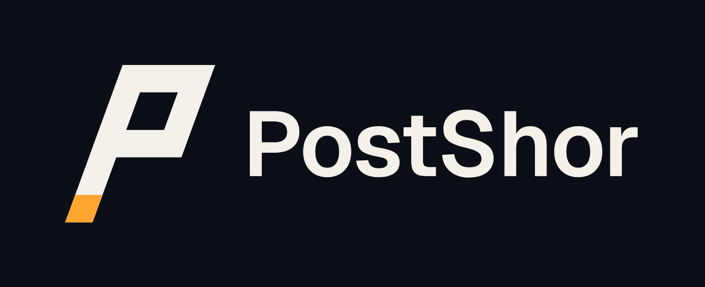
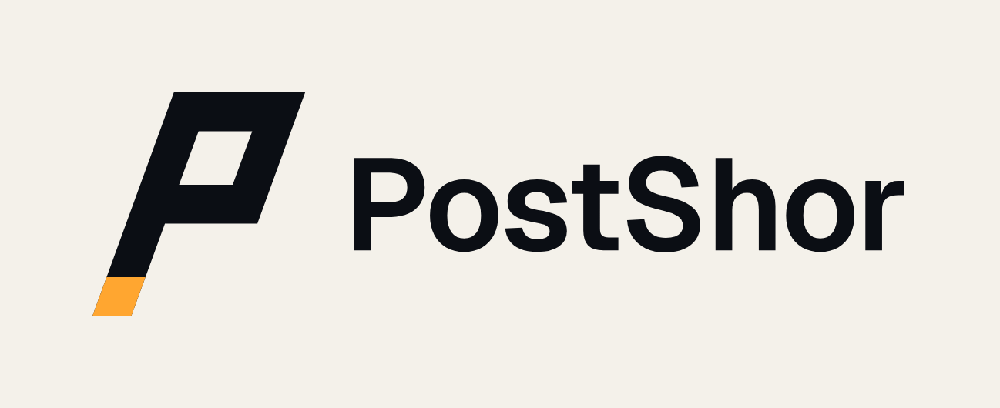
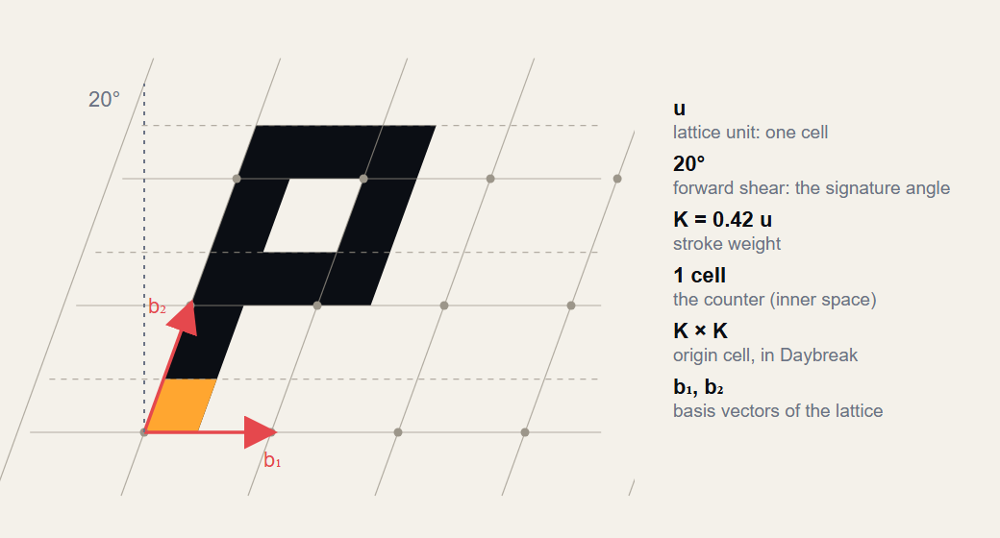
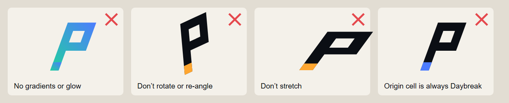
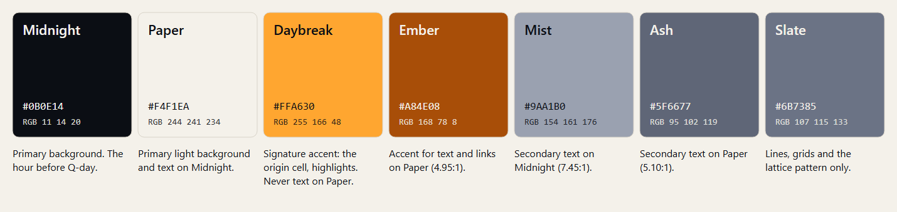

  <picture>
    <source media="(prefers-color-scheme: dark)" srcset="logo/postshor-lockup-on-dark.svg">
    
  </picture>

# PostShor Brand Guidelines

Version 1.0 · October 2026

These guidelines keep PostShor recognisable and consistent wherever it appears: in the product, on GitHub, in reports, papers and talks. They apply to everyone who represents the project.

---

## 1. The idea

**The name.** *PostShor* means the world after Shor's algorithm, the quantum algorithm that breaks RSA and elliptic-curve cryptography. Our job is to get software ready for that world.

**The symbol.** A letter **P constructed on a lattice**. Lattices are the mathematics behind ML-KEM and ML-DSA, the post-quantum standards that replace RSA and ECC. Every edge of the symbol follows the lattice:

- The lattice is **sheared 20° forward**, so the letter leans toward the future. This is our *signature angle*.
- The counter (the space inside the bowl) is **exactly one lattice cell**.
- The **origin cell** at the foot of the stem is the first cell of the lattice, coloured *Daybreak*. It stands for where every migration starts: knowing what you have.

**The colours.** *Midnight* is the time before Q-day. *Daybreak* is the post-quantum era arriving. The rest of the palette is quiet, so the one warm accent carries meaning.

---

## 2. Logo

| Asset | Use | Files |
|---|---|---|
| **Lockup** (symbol + wordmark) | Default. Use whenever space allows. | [`postshor-lockup-on-light`](logo/postshor-lockup-on-light.svg) · [`on-dark`](logo/postshor-lockup-on-dark.svg) · [`midnight`](logo/postshor-lockup-midnight.svg) · [`paper`](logo/postshor-lockup-paper.svg) |
| **Symbol** | Avatars, favicons, app icons, small spaces | [`postshor-symbol-on-light`](logo/postshor-symbol-on-light.svg) · [`on-dark`](logo/postshor-symbol-on-dark.svg) · [`midnight`](logo/postshor-symbol-midnight.svg) · [`paper`](logo/postshor-symbol-paper.svg) |
| **Wordmark** | Only where the symbol already appears nearby | [`postshor-wordmark`](logo/postshor-wordmark.svg) |
| **Avatar** | GitHub, social profiles (512 × 512) | [`postshor-avatar.png`](logo/postshor-avatar.png) |
| **Social preview** | Link previews (1280 × 640) | [`postshor-social-preview.png`](logo/postshor-social-preview.png) |

`on-light` / `on-dark` files have transparent backgrounds. `midnight` / `paper` files include their background. Prefer SVG; PNG files are provided at 2× resolution.

&nbsp;&nbsp;

### Construction

| Element | Rule |
|---|---|
| Lattice unit *u* | One cell. All proportions derive from it. |
| Signature angle | 20° forward shear. Never change it. |
| Stroke weight *K* | 0.42 *u* |
| Symbol size | (1 + *K*) *u* wide at the base, (2 + *K*) *u* tall |
| Wordmark | Geist SemiBold, tracking −1.5 %, cap height = 1 *u* |
| Lockup alignment | Wordmark cap height centred on the symbol; gap = *K u* |

### Clear space and minimum size

- **Clear space:** keep at least **one lattice cell (*u*)**, the wordmark's cap height, free on every side.
- **Minimum size:** lockup **120 px** wide on screen or **30 mm** in print; symbol **16 px** or **6 mm**.

### Don't

Don't add gradients, glows, shadows or outlines. Don't rotate, re-angle, stretch or re-draw the symbol. Don't recolour the origin cell, and don't retype the wordmark in another font. Don't place the logo on busy photos; use Midnight or Paper behind it.

---

## 3. Colour

| Name | HEX | RGB | Role |
|---|---|---|---|
| **Midnight** | `#0B0E14` | 11 14 20 | Primary dark background; text on Paper |
| **Paper** | `#F4F1EA` | 244 241 234 | Primary light background; text on Midnight |
| **Daybreak** | `#FFA630` | 255 166 48 | Signature accent: origin cell, highlights, key numbers on Midnight |
| **Ember** | `#A84E08` | 168 78 8 | Accent for text and links on Paper |
| **Mist** | `#9AA1B0` | 154 161 176 | Secondary text on Midnight |
| **Ash** | `#5F6677` | 95 102 119 | Secondary text on Paper |
| **Slate** | `#6B7385` | 107 115 133 | Lines, grids and the lattice pattern only, never text |

**Proportion:** roughly 60 % Midnight or Paper, 30 % neutrals, at most 10 % Daybreak. The accent works because it is rare.

**Accessibility (WCAG 2.1 contrast):**

| Text / background | Ratio | Use |
|---|---|---|
| Paper on Midnight | 17.1 : 1 | ✓ all text |
| Daybreak on Midnight | 9.9 : 1 | ✓ all text |
| Mist on Midnight | 7.5 : 1 | ✓ all text |
| Ash on Paper | 5.1 : 1 | ✓ all text |
| Ember on Paper | 5.0 : 1 | ✓ all text |
| Slate on Midnight / Paper | 4.1 / 4.2 : 1 | ✗ not for text (lines only) |
| Daybreak on Paper | 1.7 : 1 | ✗ never for text (graphic accent only) |

**Severity colours** (critical, high, medium, low, info) are functional, not brand colours. They are defined in the report stylesheet in the PostShor repository. Keep them out of marketing material.

---

## 4. Typography

| Role | Typeface | Weight | Notes |
|---|---|---|---|
| Wordmark, headings | **Geist** | SemiBold (600) | Tracking −1.5 % for large sizes |
| Body | **Geist** | Regular (400) | 16 px / 24 px line height on screen |
| Code, commands, data | **Geist Mono** | Regular–Medium | Use for anything a user types |

Geist and Geist Mono are free and open source ([SIL Open Font License](https://github.com/vercel/geist-font)). Fallbacks: `system-ui, sans-serif` and `ui-monospace, monospace`.

**Scale (screen):** 48 / 32 / 24 / 18 / 16 / 14 px. Sentence case for headings. No all-caps paragraphs.

---

## 5. The lattice pattern

The brand texture is the same 20° lattice the symbol is built on, drawn in thin lines one step lighter than the background (`#161B26` on Midnight). Use it as a quiet background for covers, slides and social images, never behind body text and never brighter than that.

---

## 6. Voice

PostShor speaks like a careful engineer who has read the standards.

| Do | Don't |
|---|---|
| "RSA-2048 found in 14 files. ML-KEM-768 is the replacement." | "Your encryption is DOOMED!" |
| Cite the standard: FIPS 203, NIST IR 8547, CNSA 2.0 | Claim certainty about when Q-day arrives |
| Say what to do next | List problems without a fix |
| Short sentences, plain words | Jargon without explanation |
| Admit limits: "static analysis can miss dynamic choices" | Promise "100 % quantum-safe" |

Use **harvest now, decrypt later** to explain urgency, not fear.

---

## 7. Naming

- Always **PostShor**: capital P, capital S, one word. Never *Postshor*, *POSTSHOR* or *Post-Shor*.
- Products: **PostShor** (the open-source scanner), **PostShor Cloud**, **PostShor Agility**, **PostShor Chain**, **PostShor Edge**.
- The score is the **Quantum Readiness Score (QRS)**. Its name stays vendor-neutral on purpose.
- The command is lowercase: `postshor`.

---

## 8. Legal

- The PostShor name, symbol and wordmark identify the project. They are **not** covered by the Apache-2.0 license of the source code. You may use them to refer to PostShor accurately; don't use them in ways that suggest endorsement or a different origin.
- PostShor is named after an algorithm, not a person, and is **not affiliated with or endorsed by Peter Shor**. Never imply otherwise.

---

## 9. Source files

Every asset here is generated from code in [`source/build.py`](source/build.py), so geometry and colours stay exact and any change applies everywhere. See [`source/README.md`](source/README.md).
